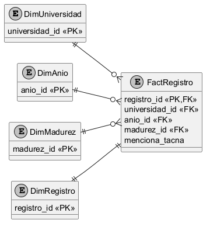
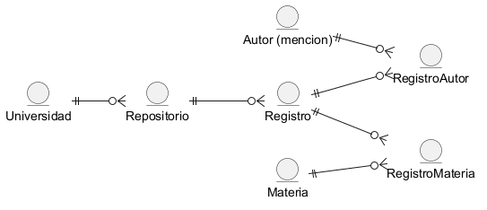

## Modelo de datos implementado

El catálogo normalizado alimenta una estrella de conteo. El grano es un registro público identificado por Handle o URL canónica cuando no hay Handle. Autores son menciones conservadas; sus nombres no prueban identidad personal.

El modelo conserva 9312 registros y publica 7683 menciones de Tacna. Generación del modelo: 2026-11-11T07:46:31.611022+00:00. Este momento no sustituye la fecha de publicación ni de extracción de cada fuente.

| Universidad | Catálogo conservado | Selección Tacna | Cobertura declarada |
| --- | --- | --- | --- |
| UNJBG | 4016 | 4016 | captura_historica_filtrada_tacna |
| UPT | 5296 | 3667 | catalogo_completo_captura |

La captura histórica UNJBG está filtrada; no se compara su catálogo total con el catálogo completo UPT. Ambas selecciones web usan la misma regla de mención de Tacna.

### Estrella compartida

FactRegistro tiene una fila por registro_id. DimUniversidad, DimAnio y DimMadurez filtran el hecho mediante claves. El catálogo DimRegistro aporta título, resumen, fechas y procedencia. Los puentes conservan autores y materias sin multiplicar las filas del hecho.

### Base normalizada

Repositorio pertenece a universidad; registro pertenece a repositorio. Las asociaciones de autor y materia usan claves compuestas. SQLite valida claves foráneas; los CSV relacionados y el JSON conservan los mismos identificadores.

### Diccionario generado

#### dim_universidad

Filas: 2.

| Campo | Tipo lógico |
| --- | --- |
| universidad_id | texto |
| sigla | texto |
| nombre | texto |

#### repositorio

Filas: 2.

| Campo | Tipo lógico |
| --- | --- |
| repositorio_id | texto |
| universidad_id | texto |
| url | texto |

#### dim_anio

Filas: 24.

| Campo | Tipo lógico |
| --- | --- |
| anio_id | entero |
| nombre | texto |

#### dim_madurez

Filas: 4.

| Campo | Tipo lógico |
| --- | --- |
| madurez_id | texto |
| nombre | texto |
| orden | entero |

#### dim_registro

Filas: 9312.

| Campo | Tipo lógico |
| --- | --- |
| registro_id | texto |
| handle | texto |
| repositorio_id | texto |
| titulo | texto |
| abstract | texto |
| enlace | texto |
| fecha_original | texto |
| fecha_publicacion | texto |
| anio_id | entero |
| precision_fecha | texto |
| estado_fecha | texto |
| fecha_ingreso_repositorio | texto |
| fecha_extraccion | texto |
| metodo | texto |
| fuente | texto |
| madurez_id | texto |
| regla | texto |
| evidencia | texto |
| version_reglas | texto |
| fecha_clasificacion | texto |

#### fact_registro

Filas: 9312.

| Campo | Tipo lógico |
| --- | --- |
| registro_id | texto |
| universidad_id | texto |
| anio_id | entero |
| madurez_id | texto |
| menciona_tacna | booleano |
| coincide_titulo | booleano |
| coincide_resumen | booleano |
| coincide_materias | booleano |

#### dim_autor

Filas: 10100.

| Campo | Tipo lógico |
| --- | --- |
| autor_id | texto |
| nombre | texto |
| nombre_normalizado | texto |
| orcid | texto |

#### dim_materia

Filas: 15504.

| Campo | Tipo lógico |
| --- | --- |
| materia_id | texto |
| nombre | texto |
| esquema | texto |
| codigo | texto |

#### puente_registro_autor

Filas: 10100.

| Campo | Tipo lógico |
| --- | --- |
| registro_id | texto |
| autor_id | texto |
| orden | entero |

#### puente_registro_materia

Filas: 44485.

| Campo | Tipo lógico |
| --- | --- |
| registro_id | texto |
| materia_id | texto |

### Reglas y calidad

Las fechas originales se conservan junto a su precisión. Un año sin mes ni día permanece como año; las fechas inválidas usan el miembro desconocido. La fecha 2026-05-8 se normaliza a 2026-05-08 sin perder su valor original.

Reglas de clasificación: versión 2.0. Cada coincidencia conserva patrón y fragmento normalizado. Sin coincidencias significa Sin evidencia textual detectada; un resumen ausente se distingue expresamente. No se verifica implementación real.

Se conservan datos completos y se filtra solamente la proyección web. Esta descarga modelo_web.json, valida claves y referencias, y reconstruye una fila por hecho. Power BI importa los CSV de estrella. El CSV antiguo conserva ocho columnas para compatibilidad; su etiqueta Teorico es heredada y no debe interpretarse como resultado verificado.

Las tablas puente requieren conteos distintos y recorridos de filtros definidos. Dos autores y tres materias no representan seis investigaciones. No se fusionan registros por título ni autores por nombre.

### Ejecución y automatización

etl/main_oaipmh.py recolecta ambas fuentes y completa UPT con HTML. Ante fallo de una fuente no publica resultados parciales. Para reproducir el modelo sin red se usa python etl/main_oaipmh.py --desde-json data/origen.json.

El workflow de documentación genera este diccionario desde manifest.json, renderiza PlantUML, produce los seis Word y PDF y ejecuta su verificador. En pull requests valida y adjunta artefactos; los commits automáticos se restringen a main.

El PBIX binario anterior se mantiene como entregable compatible; sus relaciones no se modifican automáticamente. La migración a la estrella se reproduce con powerquery/ModeloEstrella.pq, las consultas de referencia, el DAX y la guía de relaciones.
